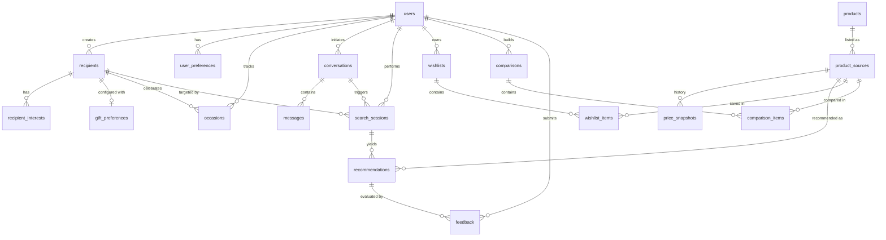

# Giftora MySQL 8.0 Database Design

Giftora utilizes a fully normalized 3NF MySQL 8.0 relational schema (`giftora_db`) with `utf8mb4` character set and InnoDB engine.

---

## 1. Entity-Relationship Model

---

## 2. Table Specifications

### 2.1 Users & Authentication
- **`users`**: UUID primary key, unique email, full name, Argon2id password hash, role (`consumer`, `admin`), active status, timestamps.
- **`user_preferences`**: 1-to-1 extension storing currency (`INR`), assistant tone, notifications, default budget ceiling.

### 2.2 Recipients & Gifting Profiles
- **`recipients`**: Person shopping for (name, relationship e.g., Sister, Partner, Friend, notes, DOB).
- **`recipient_interests`**: Normalized interest tags (e.g., Ceramics, Aromatherapy, Tech).
- **`gift_preferences`**: Specific budget bounds (min/max), preferred categories (JSON), disliked categories (JSON).
- **`occasions`**: Milestone calendar (Birthdays, Anniversaries) with reminder flags.

### 2.3 AI Chat & Search Sessions
- **`conversations`**: Chat thread sessions linked to user and optional recipient.
- **`messages`**: Chronological chat history (`user`, `assistant`, `system`).
- **`search_sessions`**: Discovery sessions with query, extracted preferences (JSON), budget range, status (`PENDING`, `COMPLETED`).

### 2.4 Products & Marketplaces
- **`products`**: Canonical product entity (name, brand, description, category, image).
- **`product_sources`**: Multi-marketplace listings (Amazon, Flipkart, Myntra) with live/mock pricing, URL, availability, rating, reviews.
- **`price_snapshots`**: Historical price tracking for price drop alerts and value scoring.
- **`recommendations`**: Ranked match outputs for a search session with relevance scores (0-100) and AI match reasons.

### 2.5 Shopping & Collections
- **`wishlists` & `wishlist_items`**: User collections of saved gift ideas.
- **`comparisons` & `comparison_items`**: Side-by-side matrices comparing up to 4 products.
- **`feedback`**: User validation signals (`relevant`, `saved`, `too_expensive`).

---

## 3. Importing into MySQL Workbench

1. Open **MySQL Workbench 8.0 CE**.
2. Connect to local instance (`localhost:3306`).
3. Open `database/schema.sql` (`File -> Open SQL Script...`).
4. Click the Lightning Bolt (Execute) icon to create `giftora_db` and all 18 tables.
5. Open `database/seed.sql` and execute to populate development seed data.
